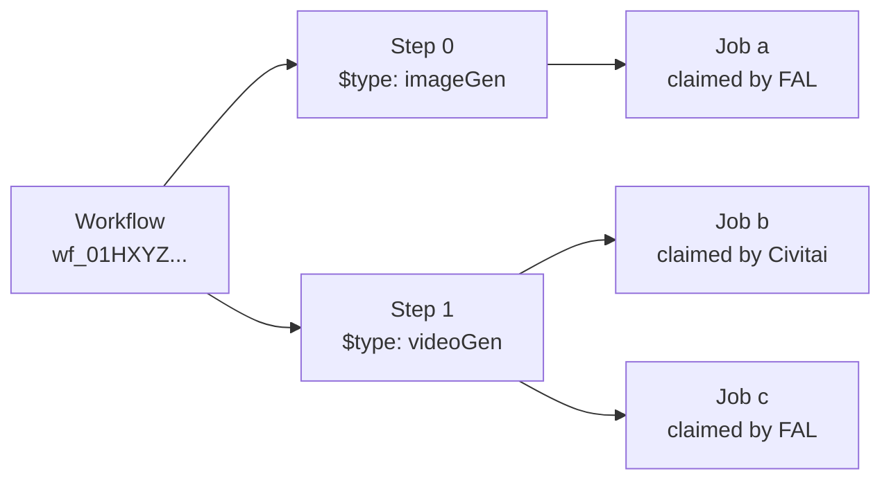

# Workflows

The orchestrator has three nested concepts. You mostly work with the first two; jobs are mostly useful for diagnostics.

- **Workflow** — what you submit. A container with metadata, tags, payment rules, and one or more steps. Identified by a `workflowId`.
- **Step** — a unit of work inside a workflow. Each step has a `$type` (the step type — `imageGen`, `videoGen`, `transcription`, …) and an `input`, and produces one or more outputs.
- **Job** — a unit of work the step needs done. A step emits zero, one or many. Compatible providers race to claim each job and the winner runs it; you don't schedule jobs directly.

(*A **recipe** is a typed endpoint at `/v2/consumer/recipes/{name}` that wraps a single-step workflow, without the polymorphic `$type`. See [The per-recipe path](./submitting-work#the-per-recipe-path).*)



## Workflows

A workflow is what you `POST` to [`SubmitWorkflow`](/orchestration/reference/operations/SubmitWorkflow). After it reaches a terminal status it stays queryable via [`GetWorkflow`](/orchestration/reference/operations/GetWorkflow) (for [30 days](./results-and-webhooks#ephemeral-workflows), unless ephemeral).

Key fields on a returned [`Workflow`](/orchestration/reference/operations/GetWorkflow):

| Field | What it tells you |
|-------|-------------------|
| `id` | Opaque workflow ID (prefixed `wf_`). |
| `status` | Current lifecycle state — see [Status lifecycle](#status-lifecycle). |
| `steps` | Array of [`WorkflowStep`](/orchestration/reference/operations/GetWorkflow) objects: the work and its results. |
| `createdAt` / `startedAt` / `completedAt` | Timing. `startedAt` is null until the orchestrator begins execution; `completedAt` is null until terminal. |
| `cost` / `transactions` | What was charged, broken down by Buzz currency — see [Submitting Work → Payments](./submitting-work#payments-buzz). |
| `tags` | Indexed strings you can filter by via [`QueryWorkflows`](/orchestration/reference/operations/QueryWorkflows). |
| `metadata` | Arbitrary JSON you attached at submission (or via [`UpdateWorkflow`](/orchestration/reference/operations/UpdateWorkflow)). Not indexed. |
| `nsfwLevel` | Content classification, computed from step outputs. |
| `callbacks` | Registered webhooks — see [Results & webhooks](./results-and-webhooks). |
| `downloadPriority` | Which lane resources this workflow needs are downloaded in — see [Download priority](#download-priority). |

The submission fields `upgradeMode`, `allowMatureContent`, `currencies`, `experimental` and `arguments` are echoed back too.

## Steps

Each entry in `steps` is a [`WorkflowStep`](/orchestration/reference/operations/GetWorkflow). Its `$type` picks the step type and therefore the `input` schema.

```json
{
  "$type": "videoGen",
  "name": "clip",
  "input": { "engine": "wan", "version": "v2.6", /* ... */ },
  "priority": "normal",
  "timeout": "00:10:00",
  "retries": 2
}
```

| Field | Purpose |
|-------|---------|
| `$type` | The step type. See the [API reference](/orchestration/reference/) for the full set (`imageGen`, `videoGen`, `imageUpscaler`, `transcription`, `textToSpeech`, `chatCompletion`, `comfy`, …). |
| `name` | Optional; lets another step refer to this one. Defaults to the array index (`"0"`, `"1"`, …). |
| `input` | Payload specific to the step type. |
| `priority` | Scheduling hint (`low`, `normal`, `high`). Higher priority jumps the queue, subject to your tier. |
| `timeout` | ISO 8601 duration; the step is marked `expired` if it runs longer. |
| `retries` | Maximum retry count before declaring the step `failed`. Each retry may claim a different provider. |

On a fetched workflow, each step also carries:

| Field | What it tells you |
|-------|-------------------|
| `status` | Per-step status. A workflow's overall status rolls up from its steps. |
| `jobs` | The concrete jobs the orchestrator ran for this step. |
| `estimatedProgressRate` | `0.0`–`1.0` progress estimate ([how it's calculated](#how-estimatedprogressrate-is-calculated)). Null if the step hasn't started. |
| `startedAt` / `completedAt` | Step-level timing. |
| `metadata` | Step-scoped metadata you attached. |
| `warnings` | Non-fatal notices, such as a deprecated model. Omitted when there are none — see [Warnings](#warnings). |

### Warnings

A step that will stop working later carries a `warnings` array. Each entry has a
machine-readable `code`, a human-readable `message`, and — for deprecations — `deprecatedAt`,
`retiresAt` and a suggested `replacement`:

```json
"warnings": [{
  "code": "modelDeprecated",
  "message": "Model 'edit-plus' is deprecated and will be retired on 2026-10-09 16:00:00Z; requests using it will be rejected from then on. Use '2.0' instead.",
  "deprecatedAt": "2026-07-10T00:00:00Z",
  "retiresAt": "2026-10-09T16:00:00Z",
  "replacement": "2.0"
}]
```

Warnings are returned on `whatif` previews too, so you can catch them before spending Buzz. The same
information is sent as [`Deprecation`](https://www.rfc-editor.org/rfc/rfc9745) and
[`Sunset`](https://www.rfc-editor.org/rfc/rfc8594) response headers, which also reach recipe endpoints
that return only a step's output. Once `retiresAt` passes, submitting the deprecated option fails with a
`400` naming the replacement.

You can amend a step, e.g. fix its `input`, while it is still `unassigned` via [`UpdateWorkflowStep`](/orchestration/reference/operations/UpdateWorkflowStep) / [`PatchWorkflowStep`](/orchestration/reference/operations/PatchWorkflowStep).

## Jobs

A step emits **zero, one, or many** jobs based on its inputs: a batch-of-4 image generation emits four, a single ChatCompletion one, a validation-only step possibly none. Compatible providers race to claim each job, and the winner runs it.

Most code can ignore `jobs` and read step-level status and output; jobs show *why* something failed, how long it queued, and which provider ran it.

| Field | Purpose |
|-------|---------|
| `id` | Internal job ID (for support / logs). |
| `status` | Same enum as workflow/step. |
| `queuePosition` | A job is queued with every compatible provider at once; this is its position in **one** of those queues, the provider most likely to claim it next. Another provider may still win. |
| `cost` | A relative **complexity** score with no unit, like a query-planner cost: `4` is roughly twice `2`. *Not* what you're charged — that's the workflow's `transactions` / `cost` ([Payments](./submitting-work#payments-buzz)). |
| `estimatedProgressRate` | `0.0`–`1.0` progress estimate — see [How `estimatedProgressRate` is calculated](#how-estimatedprogressrate-is-calculated). |
| `reason` / `blockedReason` | On failure, why (also surfaced on the step). See [Errors & retries → Step-level failures](./errors-and-retries#step-level-failures). |

Multiple jobs on a step come from one of two sources:

- **Fan-out**: the step needs several units of work (a batch of N images emits N jobs). All must succeed for the step to succeed.
- **Retries**: if `retries > 0` and a job fails transiently, a replacement job is emitted. The step succeeds as soon as the retry does.

Retry jobs appear after a failed sibling; fan-out jobs run in parallel from the start.

### How `estimatedProgressRate` is calculated

`estimatedProgressRate` is derived, not reported: `elapsed × throughput / cost`, clamped to `0.0`–`1.0`, where `cost` is the job's complexity score and throughput is the cost-per-second the worker completed on recent jobs. Use it for progress bars and ETAs, but as a hint: real completion can come earlier or later.

## Dependencies & parallelism

Steps run concurrently unless one depends on another, and so do the jobs within a step. A step's jobs start once its dependencies resolve, and a step may emit **more jobs while it's in progress**, so `jobs` is not a fixed set you can count at the start.

### What creates a dependency

A dependency is created when one step *consumes the output of another*. Anywhere a step's `input` accepts a value, you can use a reference instead:

```json
{
  "$ref": "<source name>",
  "path": "<dotted path into the source>"
}
```

The orchestrator resolves it at runtime and wires up the edge.

```json
{
  "steps": [
    {
      "$type": "imageGen",
      "name": "hero",
      "input": { "prompt": "a cat astronaut", "width": 1024, "height": 1024 }
    },
    {
      "$type": "imageUpscaler",
      "name": "hero-4k",
      "input": {
        "image": { "$ref": "hero", "path": "output.images[0].url" },
        "numberOfRepeats": 1
      }
    }
  ]
}
```

`hero-4k` stays `unassigned` until `hero` succeeds, then `image` gets the resolved URL. If `hero` fails, `hero-4k` is canceled.

**Source names** in `$ref`:

- A step's explicit `name` — e.g. `"hero"` above.
- The implicit positional name `"$0"`, `"$1"`, … if the step didn't set one (`$0` = first step, `$1` = second, …).
- `"$arguments"` to read from workflow-level arguments (see below).
- A loop variable inside `repeat`-style steps (e.g. `"frame"` if the loop is bound `as: "frame"`).

The available `path`s follow the source step's output schema (see its reference page).

### Inserting a reference into text

Add `format` to a reference to put the resolved value inside a longer string. `{0}` marks where the value goes:

```json
{
  "steps": [
    {
      "$type": "chatCompletion",
      "name": "write",
      "input": {
        "model": "…",
        "messages": [{ "role": "user", "content": "Describe a fox in a scarf in under 40 words." }],
        "responseFormat": { "type": "json_schema", "jsonSchema": { "name": "look", "schema": { "type": "object", "properties": { "look": { "type": "string" } }, "required": ["look"] } } }
      }
    },
    {
      "$type": "imageGen",
      "input": {
        "engine": "google",
        "model": "nano-banana-2-lite",
        "prompt": {
          "$ref": "write",
          "path": "output.parsed.look",
          "format": "A 3D rendered cartoon character. Full-body reference of {0}. Plain grey background."
        }
      }
    }
  ]
}
```

The model writes only the part that changes; the fixed wording stays as you wrote it.

- **Placeholders:** `{0}` is the only placeholder and can appear more than once. Write a literal brace as <code v-pre></code>. A `format` that isn't a string, has no `{0}`, or has any other unescaped brace is rejected when you submit the workflow.
- **Values:** a string is inserted as-is, and a number or boolean as its JSON text. An object or array is inserted as JSON, and a missing or `null` value inserts nothing.
- **`default`:** if `path` doesn't resolve, the `default` is inserted into `format` in the same way.
- **Result type:** the formatted text is then converted to the field's type like any other reference, so `"format": "https://example.com/{0}.png"` can fill a URL field.

### Workflow arguments

The workflow-level `arguments` field holds values steps reference, so one workflow template can be submitted many times with different arguments:

```json
{
  "arguments": {
    "prompt": "a cat astronaut",
    "seed": 42
  },
  "steps": [
    {
      "$type": "imageGen",
      "input": {
        "prompt": { "$ref": "$arguments", "path": "prompt" },
        "seed":   { "$ref": "$arguments", "path": "seed" }
      }
    }
  ]
}
```

## Deduplication & caching

Deduplication and result caching keep you from paying twice for the same work. Both are **best-effort cost optimizations** with undocumented exceptions (some step types, parameter combinations and account states bypass them), so don't build correctness on them: for exactly-once semantics, track your own `workflowId`s.

**Deduplication.** Resubmitting a workflow whose steps and arguments exactly match an earlier one typically returns a reference to the existing workflow instead of starting a new one.

### Result caching

Step outputs are cached when the step's inputs are deterministic enough to replay. A step resolved purely from cache serves the cached result and is **not charged**. Entries typically live around 30 days, not guaranteed; after an eviction the run pays full price.

## Status lifecycle

Workflows, steps, and jobs share the same [`WorkflowStatus`](/orchestration/reference/operations/GetWorkflow) enum:

```
unassigned → preparing → scheduled → processing ──▶ succeeded
                                             │
                                             ├──▶ failed
                                             ├──▶ expired
                                             └──▶ canceled
```

- `unassigned` — submitted, not yet routed to a provider
- `preparing` — assigned to a worker that is still downloading required models/resources not already cached on the fleet. `estimatedProgressRate` reflects download progress, and the step's `preparation` object lists each awaited resource with a queue position and ETA — see [Download priority](#download-priority).
- `scheduled` — waiting in the queue of a worker that has all required resources ready
- `processing` — actively running; `estimatedProgressRate` now reflects generation progress
- `succeeded` / `failed` / `expired` / `canceled` — **terminal**; status will not change again (webhook delivery [enforces this](./results-and-webhooks#delivery-semantics))

A workflow can move back and forth between `preparing` and `scheduled` (e.g. when reassigned to another worker); treat both as "queued, not started". Workflow status rolls up from steps: all succeeded → succeeded; any failed / expired / canceled → the workflow does the same.

## Download priority

Any model is submittable. If the fleet doesn't hold it yet, it is downloaded from origin first —
free, but you wait behind everyone else. `downloadPriority` decides which queue you wait in.

| Lane | Who gets it |
|------|-------------|
| `low` | Non-members, by default |
| `normal` | Members, by default |
| `high` | Anyone who pays for it |

Omit `downloadPriority` and it is derived from your membership. You may only ever set it to `high`;
`normal` and `low` are rejected with a `400`, and a workflow cannot be moved back down once boosted.

Each lane has its own concurrency, so a boosted download doesn't queue behind slower traffic. One payer's boost
lifts the resource for everyone waiting on it, but every workflow that needs a cold resource pays
its own charge.

### What it costs

Charged per distinct resource the fleet does not already hold:

- Under 512 MB: free.
- 512 MB and up: 500 Buzz per 4 GB, rounded up. A 512 MB LoRA and a 4 GB checkpoint both cost 500;
  a 4.5 GB checkpoint costs 1000.

A resource already available on the fleet is free regardless of size, and a resource two steps share
is charged once. If the workflow ends — cancelled, expired or failed — before any boosted download
has started moving, the boost is refunded in full.

### Boosting after submission

`PUT /v2/consumer/workflows/{id}` with `{"downloadPriority": "high"}` boosts a workflow that is
already running. Add `?whatif=true` to price it first — the response is the full workflow with the
updated `cost` and `transactions`, and nothing is charged or changed.

### Seeing where you are in the queue

While a step is `preparing`, its `preparation` object carries the gating resource plus the full list:

```json
{
  "resource": "urn:air:sdxl:checkpoint:civitai:1234@5678",
  "queuePosition": 3,
  "lane": "low",
  "etaSeconds": 840,
  "boostedEtaSeconds": 120,
  "resources": [
    {
      "resource": "urn:air:sdxl:checkpoint:civitai:1234@5678",
      "sizeBytes": 6900000000,
      "lane": "low",
      "queuePosition": 3,
      "etaSeconds": 840,
      "boostedEtaSeconds": 120
    }
  ]
}
```

`boostedEtaSeconds` is what the ETA would become in the `high` lane — the number to show alongside
the price. It is null once the resource is already `high`. A resource that is transferring reports
`progress` and `bytesPerSecond` instead of `queuePosition`.

The same information per resource is on [`GetResource`](/orchestration/reference/operations/GetResource)
under `availability`, whose `status` is one of `available`, `loading` (transferring — carries
`progress`, `bytesPerSecond`, `etaSeconds`), `queued` (waiting — carries `lane`, `queuePosition`,
`etaSeconds`, `boostedEtaSeconds`), `unavailable` (nothing is fetching it), or `unsupported`.

## When to look at each level

| Question | Where to look |
|----------|--------------|
| Did my request finish? What's the output? | Workflow `status` + `steps[].output` |
| Which step in a chain broke? | Per-step `status` + `reason` |
| Why did it fail for all providers? | Last job's `reason` / `blockedReason` |
| How much did it cost, split by currency? | Workflow `cost` + `transactions` |
| Was it SFW or mature? | Workflow `nsfwLevel` |

## Related

- [`SubmitWorkflow`](/orchestration/reference/operations/SubmitWorkflow) — create
- [`GetWorkflow`](/orchestration/reference/operations/GetWorkflow) — fetch
- [`QueryWorkflows`](/orchestration/reference/operations/QueryWorkflows) — list / filter
- [`UpdateWorkflow`](/orchestration/reference/operations/UpdateWorkflow) / [`PatchWorkflow`](/orchestration/reference/operations/PatchWorkflow) — amend
- [`DeleteWorkflow`](/orchestration/reference/operations/DeleteWorkflow) — cancel
- [Submitting Work](./submitting-work) — the body and query parameters you can pass at submission
- [Errors & retries](./errors-and-retries) — what step / job failures look like
